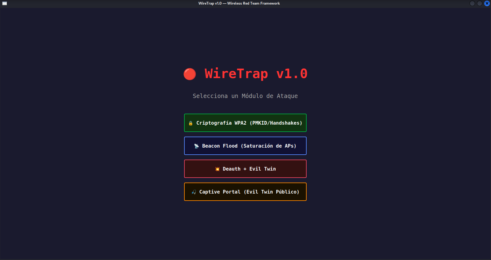
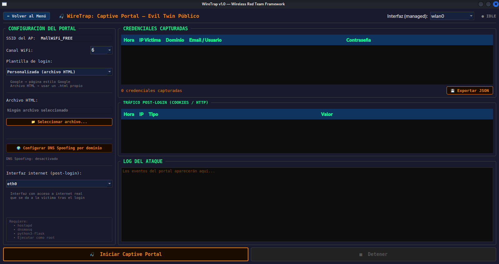

# WireTrap — Wireless Red Team Framework

Modular offensive WiFi auditing framework with a graphical interface (PyQt6), built for
practicing reconnaissance, exploitation and post-exploitation against your own or explicitly
authorized networks: from passive scanning with automatic technique recommendation, to
WPA2 PMKID/handshake cracking, AP saturation, an Evil Twin with real Internet for the victim,
and a credential-phishing captive portal with DNS Spoofing targeted at specific domains.

> ⚠️ This tool is intended for authorized environments only (your own devices/networks, or
> with explicit permission). The author is not responsible for any misuse.

## Tech Stack

- **OS:** Kali Linux
- **Language:** Python 3
- **GUI:** PyQt6
- **802.11 capture/injection:** Scapy
- **Fake AP:** hostapd + dnsmasq
- **Spectrum saturation:** mdk4 (Beacon Flood)
- **PMKID / 4-way handshake:** hcxdumptool (PMKID without connected clients), airodump-ng
  (classic handshake capture), hcxpcapngtool (conversion to `.hc22000`), hashcat (dictionary
  cracking)
- **Captive portal server:** Flask
- **HTML template adaptation:** BeautifulSoup4
- **Post-login HTTPS interception (optional):** mitmproxy + custom CA certificate
  (`cryptography` / `pyOpenSSL`)
- **Networking/firewall:** iptables (captive portal NAT + DNAT, post-login exemption)
- **Hardware tested with:** Alfa AWUS036ACH v2 (RTL8812AU) in AP mode + Alfa AWUS036ACHM
  (MT7610U) in monitor mode. Interfaces are selected from the GUI, so any adapter that
  supports both monitor mode and AP mode should work.

### Python dependencies

```bash
pip3 install PyQt6 scapy flask beautifulsoup4 cryptography pyOpenSSL requests --break-system-packages
```

### System dependencies (Kali)

```bash
sudo apt install hostapd dnsmasq mdk4 aircrack-ng hcxtools hashcat
# Optional, only needed for the Captive Portal's HTTPS interception:
pip3 install mitmproxy --break-system-packages
```

## Modules

The main menu gives access to 4 independent modules:

1. **🔒 WPA2 Cryptography (PMKID/Handshakes)** — PMKID attack without needing connected
   clients (hcxdumptool), or classic handshake capture (airodump-ng), conversion to
   `.hc22000`, and dictionary cracking with hashcat.
2. **📡 Beacon Flood** — floods the environment with hundreds of fake SSIDs via mdk4, with
   the option to announce them as WPA2 networks (🔒) for extra realism.
3. **💥 Deauth + Evil Twin** — continuous deauthentication impersonating the legitimate AP,
   an Evil Twin (hostapd + dnsmasq + NAT) with real Internet for the victim, and a live
   traffic/credential sniffer per connected client (double-click a client to open its
   dashboard).
4. **🎣 Captive Portal** — captive portal with a login template (Google style or a custom
   HTML file), a credential sniffer per victim IP (double-click to open its dashboard), and
   **DNS Spoofing by domain**: serves a page of your own when the victim visits a specific
   domain, while that domain stays in the address bar. By design (HSTS + certificate
   validation) this is only viable against **plain-HTTP** domains, not real HTTPS.

The decision engine (`core/decision_engine.py`) is a rule-based system (no AI/ML) that, based
on the security profile detected during the scan (OPEN/WEP/WPA/WPA2/WPA3), recommends which
technique to apply. Two of the techniques it can recommend (CTS Flood, Downgrade Attack) are
still theoretical and have no implemented attack module; the ones that are fully implemented
are Deauth+Evil Twin and Beacon Flood.

## Screenshots

**Main menu** — the 4 attack modules:



**Captive Portal** — fake AP configuration, login template (Google or custom HTML), DNS
Spoofing by domain, and live panels for captured credentials, post-login traffic, and the
attack log:



## Project Structure

```
WireTrap/
├── main.py                        # Entry point — checks root, launches the GUI
├── core/
│   ├── scanner.py                 # Passive 802.11 scan, channel hopping, client detection
│   ├── decision_engine.py         # Rule-based decision engine by AP security profile
│   ├── deauth.py                  # Deauth loop via Scapy
│   ├── evil_twin.py               # hostapd + dnsmasq + NAT (real Internet for the victim)
│   ├── beacon_flood.py            # AP saturation via mdk4
│   ├── wpa2_crypto.py             # PMKID / handshake / hashcat (hcxdumptool, hcxpcapngtool, hashcat)
│   └── captive_portal.py          # Portal's Flask server, templates, DNS Spoofing by domain, optional MITM
├── post_exploitation/
│   └── sniffer.py                 # Live HTTP capture: credentials, cookies, DNS, visited hosts
├── reporting/                     # Pending: PDF report generator
├── gui/
│   ├── main_window.py             # Main PyQt6 window (the 4 modules)
│   └── dashboard_dialog.py        # Per-victim-client traffic/credentials dashboard
├── utils/
│   └── oui_lookup.py              # MAC vendor lookup (with cache)
└── test_templates/                # Test HTML templates for Captive Portal / DNS Spoofing
```

## Usage

```bash
sudo python3 main.py
```

Requires root privileges (monitor mode, hostapd/dnsmasq, iptables) and, for the full Evil
Twin/Captive Portal flow, two WiFi interfaces: one in monitor mode (recon/deauth) and one in
AP mode (to bring up the fake network).
